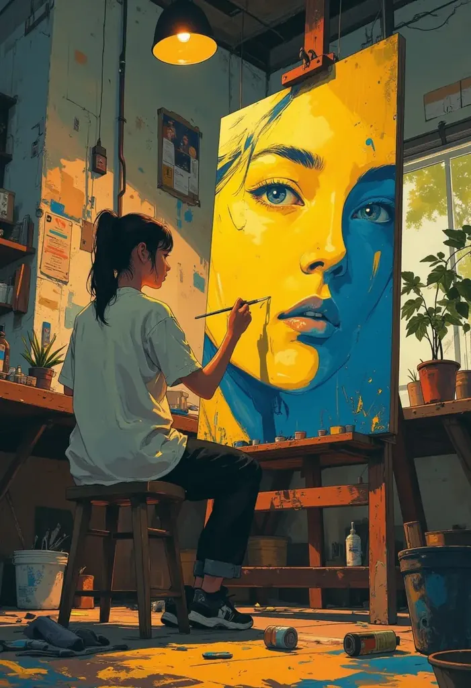
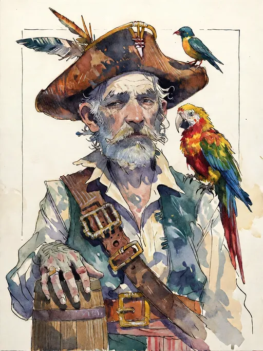

<div align="center">


# Imagica Desktop

**A local AI image studio. Make and edit pictures with the quality of ComfyUI, in a simple app, on your own computer.**

[](https://github.com/Ordryth/imagica-releases/releases/latest)
[](https://github.com/Ordryth/imagica-releases/releases)
[](https://github.com/Ordryth/imagica-releases/releases/latest)
[](LICENSE)

[**Download**](https://github.com/Ordryth/imagica-releases/releases/latest) · [Website](https://imagica.co.in) · [Docs](https://imagica.co.in/docs) · [Report a problem](https://github.com/Ordryth/imagica-releases/issues)

<br/>





</div>

---

## What it is

Imagica Desktop makes and edits AI images entirely on your computer. It sets up its own image engine (built on ComfyUI) and gives you a clean studio on top: pick a model, write a prompt, generate, edit, upscale.

- **No setup.** No Python, no node graphs, no command line. The app installs the right engine for your graphics card.
- **Private.** Prompts and pictures never leave your computer. No account is needed to generate.
- **Good results out of the box.** Every model in the catalog comes with its maker's recommended settings (sampler, steps, CFG, clip skip, VAE, prompt tags), so pictures look the way the model is meant to look.

## Features

| | |
| :--- | :--- |
| 🖼️ **Studio** | Text to image with SDXL, SD 1.5, FLUX and more. LoRAs, styles, aspect ratios, HD and 4K upscaling. |
| 🎛️ **Model settings** | Each model runs with its maker's settings. You can see and change them in the Studio. |
| ✏️ **Photo editing** | Change a whole picture, or paint over a part and describe what should be there. Your photo keeps its full size, and everything you didn't paint stays exactly as it was. |
| 🧭 **Guides** | Follow the outline, depth, pose or sketch of a reference picture (ControlNet). |
| 🧑 **Characters** | Save a person from 1–4 photos and put them in new pictures. |
| 🧩 **ComfyUI workflows** | Open a ComfyUI workflow file or picture and run it with a simple form. |
| 🎨 **Photo editor** | Crop, brush, healing, clone, blur, masks, filters and colour adjustments, with undo and redo. |
| 📥 **Models** | A curated catalog, plus Hugging Face and Civitai browsing. Downloads can be paused and resumed. |
| 🔄 **Updates** | The app updates itself when a new version comes out. |

**Not yet:** video generation and a node editor.

---

## Download

Get the latest version from the [**Releases page**](https://github.com/Ordryth/imagica-releases/releases/latest).

| System | File to download |
| :--- | :--- |
| 🪟 **Windows 10 / 11** (64-bit) | `Imagica.Desktop_<version>_x64-setup.exe` (or the `.msi`) |
| 🍏 **macOS** (Apple Silicon, M1 or newer) | `Imagica.Desktop_<version>_aarch64.dmg` |
| 🐧 **Linux**, any distribution | `Imagica.Desktop_<version>_amd64.AppImage` |
| 🐧 **Ubuntu / Debian** | `Imagica.Desktop_<version>_amd64.deb` |
| 🐧 **Fedora / openSUSE** | `Imagica.Desktop-<version>-1.x86_64.rpm` |

## Install

### Windows
1. Run the `.exe` installer.
2. If Windows SmartScreen appears, click **More info → Run anyway**.
3. Open **Imagica Desktop** from the Start menu.

### macOS
1. Open the `.dmg` and drag **Imagica Desktop** into **Applications**.
2. If macOS says the app *"is damaged and can't be opened"*, open **Terminal** and run:
   ```bash
   xattr -cr "/Applications/Imagica Desktop.app"
   ```
   Or go to **System Settings → Privacy & Security** and click **Open Anyway**.

### Linux
AppImage:
```bash
chmod +x Imagica.Desktop_*_amd64.AppImage
./Imagica.Desktop_*_amd64.AppImage
```
Ubuntu / Debian:
```bash
sudo apt install ./Imagica.Desktop_*_amd64.deb
```
Fedora / openSUSE:
```bash
sudo dnf install ./Imagica.Desktop-*.x86_64.rpm
```

### First start
On first launch the app checks your graphics card and downloads its engine (a few GB, once). Then open **Models**, download a model, and start creating in the **Studio**.

---

## System requirements

| | Minimum | Recommended |
| :--- | :--- | :--- |
| **OS** | Windows 10 64-bit, macOS 12, Ubuntu 20.04 | Windows 11, macOS 14, recent Linux |
| **RAM** | 8 GB | 16 GB or more |
| **Graphics** | Works on CPU (slow) | NVIDIA RTX with 8 GB+ VRAM, AMD with ROCm (Linux), or Apple Silicon |
| **Disk** | 15 GB free | 50 GB+ on an SSD (each model is 2–12 GB) |

---

## Help and feedback

Found a bug or have an idea? [Open an issue](https://github.com/Ordryth/imagica-releases/issues). Include your system, your graphics card and what you were doing when it happened.

## License

Released under the [Apache License 2.0](LICENSE). Models you download keep their own licenses. Check each model's page before using its pictures commercially.
